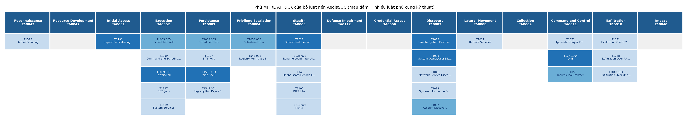

> **Ghi chú biên tập (xoá khi đưa vào Word):** Mục 2.1–2.2 (môi trường lab, Splunk, nguồn log, bridge) do bạn Splunk viết. Phần dưới đây là mục **2.3 – 2.4**. Chỗ `[Hình 2.x]` là vị trí chèn hình. Đánh số bảng lại cho liền mạch với phần 2.1–2.2.

# 2.3. Thiết kế kiến trúc tác tử AegisSOC

## 2.3.1. Bài toán và mục tiêu thiết kế

Một trung tâm giám sát an ninh (SOC) mỗi ngày nhận hàng nghìn cảnh báo từ hệ thống SIEM. Phần lớn là cảnh báo nhiễu hoặc hoạt động hợp lệ trông giống tấn công, trong khi các cuộc tấn công thật lại thường biểu hiện thành nhiều cảnh báo nhỏ, rời rạc trên nhiều nguồn dữ liệu khác nhau. Chuyên viên SOC phải đọc từng cảnh báo, tra cứu ngữ cảnh, đối chiếu tri thức về kỹ thuật tấn công rồi mới quyết định mức độ nghiêm trọng và hành động ứng phó. Đây là công việc lặp lại, tốn thời gian và dễ sai sót khi khối lượng lớn.

Tác tử AegisSOC được xây dựng để tự động hoá quy trình phân loại (triage) và đề xuất ứng phó đó, dựa trên mô hình ngôn ngữ lớn chạy cục bộ và khung tri thức MITRE ATT&CK. Khi đặt một tác tử AI vào vị trí này, có bốn yêu cầu phải được giải quyết đồng thời:

1. **Hiệu năng:** mô hình ngôn ngữ cục bộ mất khoảng 10–15 giây cho mỗi cảnh báo, không thể đọc toàn bộ luồng cảnh báo của SOC.
2. **Ngữ cảnh:** một cảnh báo đơn lẻ chỉ cho biết "luật nào khớp với sự kiện nào". Để phán đoán đúng, tác tử cần biết máy bị tác động là máy gì, nguồn có tiền sử độc hại không, và cảnh báo này có thuộc một chuỗi tấn công lớn hơn không.
3. **An toàn của chính tác tử:** tác tử đọc dữ liệu do kẻ tấn công viết ra (User-Agent, URI, dòng lệnh, truy vấn DNS) và tra cứu một kho tri thức có thể bị cài tài liệu giả, đồng thời lại có quyền đề xuất ngăn chặn. Bản thân tác tử vì vậy trở thành một bề mặt tấn công.
4. **Đo lường được:** mọi lựa chọn thiết kế phải được kiểm chứng bằng số liệu có đối chứng, không dựa vào cảm nhận.

| Yêu cầu | Thành phần đáp ứng trong AegisSOC | Mục |
|---|---|---|
| Hiệu năng | Lớp lọc trước bằng học máy theo làn | 2.3.4 |
| Ngữ cảnh | Làm giàu tất định, tương quan theo thực thể, truy xuất tri thức ba rổ | 2.3.5, 2.3.6 |
| An toàn của tác tử | Phiếu điều tra hai ngăn + bốn lớp phòng vệ | 2.3.5, 2.3.7 |
| Đo lường được | Cờ cấu hình phòng vệ, ba bộ dữ liệu đo, đường cơ sở có đối chứng | 2.3.7, 2.3.8 |

*Bảng 2.1. Yêu cầu thiết kế và thành phần đáp ứng*

Từ bốn yêu cầu trên, toàn bộ thiết kế tuân theo bốn nguyên tắc xuyên suốt:

- **Tất định trước, mô hình ngôn ngữ sau.** Mọi thứ trả lời được bằng tra cứu hoặc luật (tài sản, tình báo IP, tương quan, ánh xạ mức độ) đều làm bằng mã tất định. Mô hình ngôn ngữ chỉ đảm nhận phần cần suy luận ngữ nghĩa.
- **Mô hình ngôn ngữ không đọc dữ liệu thô.** Mô hình chỉ đọc một phiếu điều tra đã tách bạch phần hệ thống xác minh với phần do nhật ký ghi lại.
- **Không tin dữ liệu chưa xác minh nguồn gốc** — kể cả dữ liệu tự nhận là "tin cậy", như metadata của tài liệu trong kho tri thức.
- **Mọi quyết định truy vết và đo được.** Mỗi kết quả gắn với cấu hình phòng vệ đang chạy, mã phiếu điều tra và khối toàn vẹn kho tri thức đã dùng.

## 2.3.2. Kiến trúc tổng thể và luồng xử lý

AegisSOC nằm sau hệ thống SIEM: không tự phát hiện từ nhật ký thô mà nhận các cảnh báo Splunk đã phát hiện bằng 28 luật Sigma, rồi phân loại, làm giàu, suy luận và đề xuất ứng phó.

`[Hình 2.1. Kiến trúc tổng thể AegisSOC]`

```
Splunk (28 luật Sigma) ─► splunk_bridge.py ─► POST /ingest/alerts
   ─► Prefilter: gộp trùng ─► Tier 0 (web/endpoint) | Random Forest (mạng) ──(DUP/DROP: ghi lại, dừng)
   ─► Extractor ─► Correlator ─► Enricher ─► Ticket Builder ─► Retriever
   ─► Analyzer ─► Reflection ─► { Human Review | Responder } ─► Dashboard / Telegram
```

**a) Hợp đồng dữ liệu cảnh báo**

Điểm vào duy nhất của tác tử là endpoint `/ingest/alerts`. Mọi cảnh báo, dù đến từ Splunk thật hay được phát lại từ tệp để kiểm thử, đều phải tuân theo một hợp đồng dữ liệu cố định, kiểm tra bằng mô hình Pydantic với chế độ `extra="forbid"`: cảnh báo thừa hoặc thiếu trường bị từ chối ngay tại cửa vào. Nhờ đó, mọi sai lệch giữa phía SIEM và phía tác tử được phát hiện sớm thay vì lan sâu vào đồ thị xử lý.

| Trường | Kiểu | Ý nghĩa |
|---|---|---|
| `alert_id` | chuỗi | Mã duy nhất của cảnh báo |
| `rule_name` | chuỗi | Tên luật Sigma đã bắn |
| `rule_level` | low / medium / high / critical | Mức độ do luật gán |
| `attack_ids` | danh sách | Mã kỹ thuật ATT&CK của luật |
| `surface` | web / endpoint / network | Bề mặt phát sinh, dùng để điều hướng prefilter |
| `timestamp` | ISO 8601 UTC | Thời điểm sự kiện |
| `src_ip`, `dest_ip`, `dest_port` | IP / số | Được kiểm định dạng |
| `host` | chuỗi | Tên máy (endpoint) hoặc cảm biến |
| `fields` | từ điển | Giá trị gốc của sự kiện, giữ nguyên không cắt, không làm sạch |
| `summary` | chuỗi | Tóm tắt để hiển thị, không đưa vào mô hình ngôn ngữ |

*Bảng 2.2. Hợp đồng dữ liệu cảnh báo*

**b) Xử lý bất đồng bộ**

Vì mỗi cảnh báo cần 10–15 giây suy luận, endpoint trả mã 202 ngay khi nhận và phân tích trong nền, để bridge không hiểu nhầm là lỗi rồi gửi lại. Chế độ `wait=true` chỉ dùng cho bộ đo và công cụ phát lại, khi cần nhận kết quả đồng bộ.

**c) Các tầng lọc cảnh báo: lọc ở đâu, lọc cái gì**

Một cảnh báo phải đi qua nhiều tầng lọc trước khi dẫn tới hành động. Các tầng không trùng việc nhau: tầng đầu loại nhật ký không khớp luật, các tầng giữa giảm tải cho mô hình ngôn ngữ, các tầng sau xử lý những ca lành tính chỉ nhận ra được nhờ ngữ cảnh, và tầng cuối giữ lại quyền hành động cho con người.

| # | Tầng lọc | Vị trí | Áp dụng cho | Loại bỏ / nhận ra cái gì | Cơ chế | Khi khớp |
|----|------------|------------|-----------|--------------------------|------------|--------------|
| 1 | Luật phát hiện Sigma | Splunk, trước tác tử | Mọi nhật ký | Chỉ sự kiện khớp một trong 28 luật mới thành cảnh báo | Tất định | Không sinh cảnh báo |
| 2 | Hợp đồng dữ liệu, token | Cửa vào `/ingest/alerts` | Mọi cảnh báo | Thiếu, thừa hoặc sai kiểu trường; IP sai định dạng; thiếu token | Tất định | Từ chối, ghi log |
| 3 | Gộp trùng D1/D2 | Prefilter | Web, endpoint, mạng | Gửi lại cùng mã trong 60 s; nội dung giống hệt, cách nhau ≤ 10 s | Tất định | `DUP`, đếm số lần lặp |
| 4 | Tier 0 — nhiễu kỹ thuật | Prefilter, làn luật | Web, endpoint | Luật giám sát (health check, heartbeat...) mức ≤ low, không có mã ATT&CK | Tất định | `DROP`, vẫn ghi lại |
| 5 | Random Forest hiệu chuẩn | Prefilter, làn học máy | Mạng | Luồng có xác suất tấn công dưới dải bất định | Học máy | `DROP` / `PASS_UNCERTAIN` / `PASS` |
| 6 | Ngữ cảnh lành tính khi phán quyết | Enricher → Analyzer | Cảnh báo đã vào tác tử | Máy quét IT, bộ cân bằng tải, tài khoản dịch vụ, báo nhầm đã biết của luật | Mô hình ngôn ngữ trên dữ liệu tra cứu | `downgrade_benign` → low |
| 7 | Allowlist ngữ cảnh cho chuỗi | Correlator → Analyzer | Sự cố nhiều cảnh báo | Chuỗi đa tactic mà mọi sự kiện là hoạt động đã khai báo (đúng người, tactic, giờ) | Tất định | Bỏ qua R1/R2, không hạ mức |
| 8 | Cổng hành động | Responder | Mọi kết luận | Mọi lệnh chặn | Tất định + con người | `block_pending` chờ duyệt; SOAR mô phỏng |

*Bảng 2.3. Các tầng lọc cảnh báo của AegisSOC*

Mã nguồn và cấu hình của từng tầng:

- Tầng 2: `api/alert_adapter.py` (mô hình Pydantic), `api/main.py` (kiểm token).
- Tầng 3–5: `agent/nodes/prefilter.py`; luật nhiễu và tham số gộp trùng ở `assets/prefilter_rules.yaml`; mô hình ở `prefilter/model.py`, đặc trưng luồng ở `core/flow_features.py`.
- Tầng 6: `agent/nodes/enricher.py` tra `assets/inventory.yaml` (tài sản, tài khoản) và `threat_intel/local_iocs.yaml`; quyết định ở `agent/nodes/analyzer.py`.
- Tầng 7: `core/benign_context.py` với mẫu ở `assets/benign_context.yaml`, gọi từ `core/attack_kb.py`.
- Tầng 8: `agent/nodes/responder.py` (ma trận ứng phó, Rule of Two).

Các tệp YAML được nạp lại tự động khi thay đổi, nên chỉnh danh sách nhiễu, kiểm kê hay mẫu ngữ cảnh không cần khởi động lại tác tử.

Ba điểm thiết kế chung:

- **Loại hẳn chỉ xảy ra ở tầng 1–5**, và tầng 3–5 chỉ loại khi chắc chắn. Cảnh báo bị loại ở prefilter vẫn được ghi vào `/prefilter/recent` để kiểm tra lại. Từ tầng 6 trở đi, cảnh báo đã vào tác tử thì không bị xoá, chỉ được xếp mức và chọn hành động.
- **Lỗi thì cho qua (fail-open) ở tầng 3–5 và 7.** Thiếu tệp cấu hình, thiếu mô hình hay thiếu dữ liệu luồng thì cảnh báo vẫn đi tiếp, vì bỏ lọt tấn công đắt hơn tốn thêm một lượt suy luận. Riêng tầng 7, lỗi nghĩa là không có mẫu nào, nên luật nâng mức vẫn chạy nguyên vẹn.
- **Chỉ tầng 6 có mô hình ngôn ngữ tham gia**, và mô hình chỉ đọc dữ liệu tra cứu tất định (kiểm kê tài sản, IOC, tài khoản) trong ngăn tin cậy của phiếu điều tra, không đọc chữ nào do kẻ tấn công viết làm căn cứ lành tính. Các tầng còn lại không dùng mô hình ngôn ngữ, nên kẻ tấn công không thể "nói" để được cho qua.

Tier 1 cũ (Extractor dùng biểu thức chính quy tìm dấu hiệu tấn công) không nằm trong đường cảnh báo, lý do ở mục 2.3.4 e.

## 2.3.3. Đồ thị trạng thái với LangGraph

Quy trình phân tích được tổ chức thành một đồ thị trạng thái gồm chín nút trên nền LangGraph. Trạng thái (`SOCAgentState`) được truyền xuyên suốt giữa các nút, mỗi nút đọc phần mình cần và ghi phần mình tạo ra, nhờ đó mọi bước trung gian đều quan sát và kiểm toán được.

`[Hình 2.2. Đồ thị trạng thái chín nút]`

| Thứ tự | Nút | Loại xử lý | Đầu ra chính |
|---|---|---|---|
| 1 | Extractor | Tất định (regex, giải mã nhiều tầng) | IP, cổng, gợi ý chỉ báo tấn công |
| 2 | Correlator | Tất định | Mã incident, tactic ATT&CK, chuỗi tactic của sự cố, luật nâng mức (có xét allowlist ngữ cảnh) |
| 3 | Enricher | Tất định (tra cứu) | Tài sản, tài khoản, tình báo IP, lịch sử |
| 4 | Ticket Builder | Tất định | Phiếu điều tra hai ngăn |
| 5 | Retriever | Truy xuất lai (vector + BM25) | Ngữ cảnh tri thức, khối toàn vẹn kho |
| 6 | Analyzer | Mô hình ngôn ngữ | Quyết định so với luật, mã ATT&CK, độ mạnh bằng chứng |
| 7 | Reflection | Mô hình ngôn ngữ + luật | Cờ mâu thuẫn tri thức, độ tin cậy sau kiểm |
| 8 | Human Review | Điều kiện | Dừng chờ người duyệt |
| 9 | Responder | Tất định | Hành động ứng phó (chế độ mô phỏng), khuyến nghị mitigation ATT&CK |

*Bảng 2.4. Chín nút của đồ thị trạng thái*

Sáu trên chín nút là tất định. Mô hình ngôn ngữ chỉ xuất hiện ở Analyzer và Reflection, và **không nút mô hình ngôn ngữ nào được trực tiếp gọi công cụ hay thực thi hành động**: đầu ra của chúng chỉ là nhãn có cấu trúc, còn việc chuyển nhãn thành hành động do Responder tất định đảm nhận. Đây là nền tảng cho lớp phòng vệ thứ nhất (mục 2.3.7). Sau Reflection, một cạnh điều kiện chuyển sang Human Review khi phát hiện mâu thuẫn tri thức hoặc mô hình gặp lỗi, ngược lại chuyển sang Responder.

## 2.3.4. Lớp lọc trước (prefilter): gộp trùng, nhiễu kỹ thuật và học máy

**a) Vai trò**

Lớp lọc trước (tầng 3–5 của Bảng 2.3) là "người gác cổng" đứng trước toàn bộ đồ thị. Trong vài mili-giây, nó quyết định một cảnh báo có đáng để mô hình ngôn ngữ đọc hay không, giúp tác tử tập trung tài nguyên vào những cảnh báo có khả năng là tấn công.

**b) Thiết kế theo làn**

Một mô hình học máy chỉ lọc được loại dữ liệu mà nó được huấn luyện. Bộ dữ liệu UNSW-NB15 mô tả *hình dáng của kết nối mạng* (thời lượng, số gói, số byte, giao thức), không chứa nội dung yêu cầu web hay thông tin tiến trình. Vì vậy prefilter được thiết kế theo làn, điều hướng bằng trường `surface`:

| Bề mặt | Làn | Lý do |
|---|---|---|
| network (Suricata) | Học máy — Random Forest hiệu chuẩn | Các trường `flow.*` của Suricata tính được đúng 12 đặc trưng UNSW-NB15 |
| web (Nginx) | Luật (Tier 0 + gộp trùng) | Không có đặc trưng luồng; nội dung yêu cầu cần suy luận ngữ nghĩa |
| endpoint (Sysmon) | Luật (Tier 0 + gộp trùng) | Dữ liệu huấn luyện không có dòng lệnh, quan hệ tiến trình cha – con |

*Bảng 2.5. Các làn của prefilter*

Thiết kế theo làn cho phép mở rộng: bổ sung một mô hình hành vi cho endpoint hay một mô hình phân loại yêu cầu HTTP chỉ là đăng ký thêm một làn, không thay đổi các thành phần còn lại.

**c) Đặc trưng và công thức tính**

Prefilter dùng phiên bản 12 cột của UNSW-NB15, gồm các đặc trưng mà Suricata cũng đo được. Phiên bản này loại bỏ `sttl/dttl`, hai đặc trưng được biết là làm lộ nhãn trong bộ dữ liệu. Khi chạy thật, hệ thống tự tính các cột phái sinh từ dữ liệu Suricata; công thức được kiểm ngược trên chính dữ liệu UNSW-NB15 và khớp tới sai số khoảng 10⁻⁸:

| Đặc trưng | Nguồn Suricata | Cách tính |
|---|---|---|
| `dur` | `flow.start`, `flow.end` | end − start |
| `spkts`, `dpkts` | `flow.pkts_toserver`, `flow.pkts_toclient` | lấy thẳng |
| `sbytes`, `dbytes` | `flow.bytes_toserver`, `flow.bytes_toclient` | lấy thẳng |
| `proto`, `service` | `proto`, `app_proto` | mã hoá theo bảng mã của bộ dữ liệu |
| `smean`, `dmean` | tính | round(sbytes / spkts), round(dbytes / dpkts) |
| `rate` | tính | (spkts + dpkts − 1) / dur |
| `sload`, `dload` | tính | (sbytes − smean)·8 / dur ; (dbytes − dmean)·8 / dur |

*Bảng 2.6. Ánh xạ trường Suricata sang đặc trưng (khi dur = 0 thì rate = sload = dload = 0)*

Bảng mã hoá `proto`/`service` được sao chép cùng mô hình mỗi lần huấn luyện, bảo đảm lúc chạy thật mã hoá đúng như lúc học. Thiếu bảng mã thì prefilter không đoán mò mà cho cảnh báo đi qua.

**d) Hiệu chuẩn, ngưỡng theo chi phí và dải bất định**

Với SOC, độ chính xác (accuracy) không phải thước đo phù hợp. Câu hỏi đúng là: *ở ngưỡng đang dùng, bao nhiêu cuộc tấn công bị bỏ lọt?* Bỏ lọt một tấn công đắt hơn nhiều so với để lọt một cảnh báo lành tính lên tác tử. Ba bước sau được áp dụng ở tầng quyết định:

1. **Hiệu chuẩn xác suất** bằng hồi quy isotonic trên tập hiệu chuẩn tách riêng, để đầu ra của Random Forest trở thành xác suất đúng nghĩa.
2. **Ngưỡng theo chi phí** t = C_FP / (C_FP + C_FN). Với tỷ lệ chi phí bỏ lọt : báo nhầm là 10 : 1, t = 1/11 ≈ 0,09 thay vì 0,5 mặc định.
3. **Dải bất định** phía trên ngưỡng: cảnh báo rơi vào dải luôn được đẩy lên tác tử, kèm ghi chú "prefilter không chắc".

| Quyết định | Điều kiện | Xử lý |
|---|---|---|
| `DROP` | p dưới ngưỡng | Không vào tác tử, **vẫn được ghi lại** để kiểm tra sau |
| `PASS_UNCERTAIN` | trong dải bất định | Vào tác tử; ghi "không chắc" vào ngăn tin cậy của phiếu |
| `PASS` | trên dải | Vào tác tử bình thường |

*Bảng 2.7. Ba quyết định của prefilter*

Nguyên tắc an toàn: thiếu dữ liệu luồng, chưa có mô hình, thiếu bảng mã, lỗi đọc tệp cấu hình, hoặc cảnh báo ở làn luật không thuộc diện nhiễu kỹ thuật → **luôn cho qua**. Prefilter không bao giờ vì lỗi dữ liệu mà bỏ một cảnh báo, và chỉ quyết định cảnh báo có vào tác tử hay không, không can thiệp vào phán quyết.

**e) Làn luật: nhiễu kỹ thuật và gộp trùng**

Hai bước tất định này đứng trước cả hai làn, cấu hình trong `assets/prefilter_rules.yaml`.

*Tier 0 — nhiễu kỹ thuật (web, endpoint).* Một cảnh báo chỉ bị loại khi thoả đồng thời ba điều kiện: tên luật khớp mẫu nhiễu (health check, heartbeat, keep-alive, báo cáo số đo, đồng bộ tài sản), mức luật không vượt `low`, và cảnh báo **không có mã ATT&CK**. Điều kiện cuối bảo đảm một luật phát hiện tấn công không bị loại chỉ vì tên giống nhiễu. Cảnh báo bị loại vẫn được ghi vào `/prefilter/recent` để kiểm tra sau.

*Gộp trùng (mọi bề mặt).* Có hai tầng. Tầng D1 loại cảnh báo gửi lại cùng `alert_id` trong 60 giây, tình huống xảy ra khi cầu nối hết thời gian chờ và gửi lại. Tầng D2 loại cảnh báo có **nội dung giống hệt** (luật, mức, mã ATT&CK, bề mặt, nguồn, đích, cổng, máy và toàn bộ trường gốc) khi thời điểm sự kiện cách nhau không quá 10 giây. Với cảnh báo mạng, trường gốc chứa đặc trưng luồng, nên hai luồng khác nhau không bị coi là trùng và mô hình học máy vẫn chấm riêng từng luồng. Bản trùng không vào tác tử nhưng được đếm vào `repeat_count` của cảnh báo gốc. Cửa sổ 10 giây được chọn đủ ngắn để không gộp các lần lặp có chủ ý cách nhau 30 giây (ví dụ quản trị viên chạy lại một lệnh), vì số lần lặp là một phần của bằng chứng.

*Vì sao Tier 1 (Extractor dùng biểu thức chính quy) không chuyển sang đường cảnh báo.* Biểu thức chính quy của Extractor nhắm vào nội dung log web (SQLi, RCE, SSRF...). Cảnh báo endpoint đến từ luật Sigma thường không khớp biểu thức nào, nên nếu áp Tier 1 thì tấn công thật sẽ bị coi nhầm là "sạch" và bị loại. Tier 1 vì vậy chỉ còn ở đường nhận log thô (`/analyze/batch`).

## 2.3.5. Thiết kế các nút xử lý

**a) Extractor — trích xuất dấu hiệu**

Extractor duyệt đệ quy cấu trúc dữ liệu cảnh báo (giới hạn độ sâu để chống dữ liệu lồng vô hạn), giải mã nhiều tầng (URL, Base64) và gắn nhãn chỉ báo tấn công bằng tập biểu thức chính quy. Kết quả được coi là **gợi ý** (`extractor_hints`): prompt ghi rõ đây là khớp từ khoá và có thể sai, mô hình phải đối chiếu lại với dữ liệu.

**b) Correlator — tương quan theo thực thể**

Một chuỗi tấn công thường đi qua nhiều bề mặt: cảnh báo web có IP nguồn là máy tấn công, nhưng cảnh báo Sysmon về tiến trình lạ trên máy web lại không có IP nguồn mà chỉ có tên máy. Nếu chỉ gộp theo IP nguồn, các bước của cùng một cuộc tấn công sẽ bị tách thành nhiều sự cố. Vì vậy Correlator gán cho mỗi cảnh báo hai **thực thể**, quy về tên tài sản khi có trong kiểm kê (một IP và một tên máy có thể cùng chỉ một tài sản):

- *actor* — ai đang hành động: IP nguồn, hoặc chính máy với cảnh báo endpoint;
- *target* — ai bị tác động: IP đích, hoặc chính máy.

Hai luật gộp trong cửa sổ 15 phút:
1. **Cùng actor** với một cảnh báo trước.
2. Actor hiện tại **là target của một cảnh báo trước ở tactic Initial Access, Execution, Persistence hoặc Privilege Escalation** — "máy vừa bị khai thác nay tự hành động", ví dụ máy web sinh tiến trình lạ hoặc gửi dữ liệu ra ngoài.

Hệ thống cố ý **không gộp chỉ vì cùng target**, để tránh mọi cảnh báo nhắm vào máy web (kể cả kiểm tra sức khoẻ định kỳ của bộ cân bằng tải) dồn vào một sự cố.

**Giai đoạn và chuỗi theo MITRE ATT&CK.** Giai đoạn của mỗi cảnh báo được lấy trực tiếp từ dữ liệu ATT&CK chính thức (bộ STIX CTI của MITRE), không đoán theo từ khoá: đó là **tactic chính** của mã kỹ thuật mà luật gắn, quy ước là tactic đầu tiên ATT&CK liệt kê cho mã đầu tiên của luật. Ví dụ T1505.003 Web Shell thuộc Persistence (TA0003), T1082 System Information Discovery thuộc Discovery (TA0007), T1105 Ingress Tool Transfer thuộc Command and Control (TA0011). Mỗi cảnh báo chỉ mang một tactic chính, để một cảnh báo đơn lẻ không tự "trải" nhiều giai đoạn (T1053.005 Scheduled Task thuộc cùng lúc ba tactic). Cảnh báo không có mã ATT&CK mới dùng phân loại theo từ khoá. Mỗi sự cố vì vậy mang một **chuỗi tactic** sắp theo thứ tự của ma trận Enterprise (15 tactic). Chuỗi này là đầu vào cho luật nâng mức ở Analyzer và cho khuyến nghị ứng phó ở Responder.

**c) Enricher — làm giàu ngữ cảnh tất định**

Trước một cảnh báo, chuyên viên SOC luôn hỏi ba câu: máy bị tác động là máy gì và quan trọng cỡ nào; nguồn có tiền án không; trước đó đã có chuyện gì. Cả ba đều có đáp án tra cứu được, nên Enricher trả lời bằng tra cứu tất định. Dùng mô hình ngôn ngữ ở đây chỉ thêm rủi ro bịa thông tin.

| Câu hỏi | Nguồn | Ghi chú |
|---|---|---|
| Máy này là máy gì? | `assets/inventory.yaml` | Vai trò, mức quan trọng, cờ `auto_block_allowed` |
| Tài khoản này là ai? | Mục `accounts` của kiểm kê | Quản trị viên, tài khoản dịch vụ và hoạt động bình thường của nó |
| IP có tiền án không? | `threat_intel/local_iocs.yaml`, AbuseIPDB | IP nội bộ chỉ tra danh sách nội bộ; IP công khai tra AbuseIPDB, lưu đệm 24 giờ |
| Trước đó có gì? | Dòng thời gian sự kiện | Đóng gói thành câu tóm tắt |

*Bảng 2.8. Các nguồn làm giàu*

Kiểm kê sửa là có hiệu lực ngay ở cảnh báo kế tiếp, không cần khởi động lại.

**d) Ticket Builder — phiếu điều tra hai ngăn**

Mô hình ngôn ngữ không đọc dữ liệu thô. Thứ duy nhất Analyzer và Reflection đọc là **phiếu điều tra** do Ticket Builder dựng, gồm hai ngăn tách bạch:

| Ngăn | Nội dung | Nguồn gốc | Kẻ tấn công viết được? |
|---|---|---|---|
| **trusted** | Luật đã bắn, mức, mã ATT&CK (đã kiểm định dạng); IP, cổng, tên máy (đã kiểm); kết quả làm giàu; mã incident; quyết định prefilter | Hệ thống tính | Không — không chứa ký tự nào lấy từ `fields` |
| **untrusted** | Giá trị gốc của sự kiện (User-Agent, URI, body, dòng lệnh, truy vấn DNS); các giá trị hợp đồng không qua kiểm định | Nhật ký ghi lại | Có |

*Bảng 2.9. Phiếu điều tra hai ngăn*

Tách hai ngăn mang lại ba lợi ích. Một là mô hình luôn biết phần nào là sự thật đã xác minh, phần nào là lời kể của nhật ký. Hai là lớp phòng vệ spotlighting biết chính xác phần cần đánh dấu là dữ liệu. Ba là mọi quyết định truy ngược được về đúng dữ liệu mà mô hình đã nhìn thấy, qua mã phiếu (`ticket_id`).

**e) Retriever — truy xuất tri thức ba rổ** (chi tiết kho tri thức ở mục 2.3.6)

1. **Luật đã bắn cảnh báo** — tra đúng luật theo tên chuẩn hoá, lấy mô tả và mục "Known false positives".
2. **Kỹ thuật ATT&CK của luật** — tổng quan và cách phát hiện từ MITRE ATT&CK CTI.
3. **Tài liệu liên quan** — tìm lai giữa tìm kiếm vector (ngưỡng cosine 0,35) và BM25, gộp hạng bằng Reciprocal Rank Fusion, tối đa 2 tài liệu.

Mỗi rổ có hạn mức riêng; tổng ngữ cảnh giới hạn 3.500 ký tự. Prompt ghi rõ tài liệu ở rổ 3 "có thể không khớp, không được lấy mức của luật khác". Mỗi lượt truy xuất trả thêm một **khối toàn vẹn** liệt kê tài liệu đã vào ngữ cảnh, tài liệu lạ đã lọt và tài liệu lạ đã bị loại, phục vụ lớp phòng vệ thứ năm và phép đo đầu độc tri thức.

**f) Analyzer — suy luận có cấu trúc**

Analyzer dùng Llama 3.1 8B Instruct chạy cục bộ qua Ollama. Toàn bộ dữ liệu điều tra không rời hạ tầng nội bộ. Tham số được cố định để kết quả ổn định và tái lập được:

```python
llm = ChatOllama(model="llama3.1",
                 temperature=0.0,      # phán quyết an ninh phải tái lập được
                 num_ctx=4096,         # cố định cửa sổ ngữ cảnh, tránh tự cắt prompt
                 num_predict=700)      # giới hạn độ dài câu trả lời
```

Thiết kế then chốt của Analyzer là **câu hỏi đặt cho mô hình**. Đo trên bộ kịch bản vàng cho thấy mô hình 8B không có thang đo ổn định cho bốn mức độ: khi được yêu cầu tự gán mức, mô hình thường lệch một bậc dù đã nhận diện đúng bản chất sự kiện. Vì vậy Analyzer không hỏi "sự kiện này mức gì?" mà hỏi **"mức mà luật đã gán có đúng với cảnh báo này không?"**, và mô hình chỉ được chọn một trong bốn quyết định. Mức cuối cùng được tính bằng mã tất định:

| Quyết định | Khi nào mô hình chọn | Mức cuối |
|---|---|---|
| `keep_rule_level` | Bằng chứng khớp mô tả luật, ngữ cảnh không làm thay đổi (mặc định) | Giữ mức luật |
| `downgrade_benign` | Ngữ cảnh cho thấy hoạt động hợp lệ (máy quét IT, tài khoản dịch vụ, khớp "Known false positives") và không có dấu hiệu tấn công khác | low |
| `downgrade_one` | Bằng chứng yếu hơn mô tả luật (thử thất bại, không trọn vẹn) nhưng không hợp lệ | Hạ một bậc |
| `upgrade_one` | Có bằng chứng vượt luật: tiến trình lạ do web server sinh ra, IP trong danh sách độc hại, nhiều bước tấn công từ cùng nguồn | Nâng một bậc |

*Bảng 2.10. Bốn quyết định của Analyzer*

Cách này để mô hình làm đúng việc nó giỏi (so sánh ngữ nghĩa giữa bằng chứng và mô tả luật), còn ánh xạ ra thang mức thuộc về mã tất định. Mọi thay đổi mức đều mang một lý do có tên, thuận tiện cho kiểm toán và đo lường. Đầu ra được ràng buộc bằng Pydantic (Structured Output); nếu mô hình trả JSON rỗng, nút được thử lại một lần.

**Luật nâng mức theo tiến triển tactic ATT&CK.** Mô hình 8B rất hiếm khi chọn `upgrade_one`, nên nếu chỉ dựa vào mô hình thì các sự cố nhiều bước gần như không bao giờ được xếp critical. Việc nhận ra một cuộc xâm nhập đang tiến triển vì vậy không giao cho mô hình mà do hai luật tất định, định nghĩa từ cấu trúc ma trận ATT&CK trước khi đo:

- **R1 — Xâm nhập nhiều giai đoạn:** sự cố trải từ **3 tactic khác nhau** trở lên → mức tối thiểu **critical**.
- **R2 — Hậu khai thác:** một tactic hậu khai thác (Persistence, Privilege Escalation, Credential Access, Lateral Movement, Collection, Command and Control, Exfiltration, Impact) xuất hiện **sau** Initial Access hoặc Execution trong cùng sự cố → mức tối thiểu **high**.

**Allowlist ngữ cảnh benign.** R1 và R2 chỉ nhìn tactic, không biết *ai* thực hiện, nên một chuỗi lành tính đa tactic (quản trị viên đăng nhập, tạo tác vụ định kỳ, sao lưu) có thể kích hoạt nhầm. Bước kiểm tra ngữ cảnh (`core/benign_context.py`, dữ liệu `assets/benign_context.yaml`, tất định, không dùng mô hình) bỏ qua R1/R2 **chỉ khi mọi sự kiện có tactic của sự cố đều được một mẫu đã khai báo giải thích**. Một sự kiện được giải thích khi đồng thời: (1) danh tính khớp (tài khoản trường `User` hoặc máy phát động theo kiểm kê); (2) tactic nằm trong danh sách mà mẫu mong đợi; (3) nằm trong khung giờ của mẫu, nếu có; (4) nguồn không có trong IOC nội bộ và luật không ở mức critical. Chỉ cần một sự kiện lạ (tài khoản khác, tactic ngoài danh sách, ngoài giờ, IP có tiền án) thì R1/R2 áp lại như cũ, vì chuỗi được tính lại ở mỗi cảnh báo mới. Bỏ qua chỉ có nghĩa là *không nâng*: không có mức nào bị hạ, cảnh báo vẫn đi qua Analyzer, và lý do bỏ qua (luật nào, mẫu nào) được ghi vào audit trail và hiển thị cho người duyệt. Các mẫu bám đúng mô tả tài khoản và máy trong kiểm kê tài sản, không viết theo bộ kịch bản đo.

Hai luật chỉ nâng, không bao giờ hạ. Khi một luật kích hoạt, độ mạnh bằng chứng được đặt tối thiểu 0,7, vì chuỗi tactic là bằng chứng tương quan tất định; tên luật, mức cũ, mức mới và chuỗi tactic được ghi vào audit trail. Cảnh báo lặp lại cùng một kỹ thuật (cùng một tactic) không kích hoạt luật nào: tần suất không phải là tiến triển của cuộc tấn công.

**g) Reflection — kiểm toán chéo**

Reflection đóng vai kiểm toán viên nội bộ, kiểm tra tài liệu tham khảo có mâu thuẫn với bằng chứng không. Ba quy tắc giữ cho bước này chính xác:

- Cờ mâu thuẫn do mô hình tự bật **chỉ có hiệu lực khi Analyzer đã hạ mức**. Đây đúng là mô hình đe doạ của đầu độc tri thức: tài liệu giả khiến tác tử phản ứng nhẹ đi. Nếu không có ràng buộc này, mô hình bật cờ ở hầu hết các ca chỉ vì "không chắc".
- Một luật tất định dò các cụm từ hạ mức điển hình trong tài liệu tham khảo, bỏ qua các dòng "Known false positives" hợp lệ của luật Sigma.
- Reflection **chỉ được hạ độ tin cậy, không được nâng**.

Đầu ra của Reflection được đọc theo cách **dung sai**: chấp nhận nhiều tên gọi tương đương của cùng một trường (`AliasChoices`) và có giá trị mặc định an toàn. Mô hình 8B thỉnh thoảng gõ nhầm tên trường; khi đó nút giữ nguyên phán quyết thay vì lỗi và đẩy cảnh báo sang người duyệt.

**h) Responder — ma trận ứng phó**

| Mức cuối | Bằng chứng | Hành động |
|---|---|---|
| critical | ≥ 0,90 | `network_block_full` (chặn vào/ra/chuyển tiếp) |
| critical | < 0,90 | `block_ip` |
| high | ≥ 0,5 | `block_ip` |
| high / critical | < 0,5 | `alert_operator` |
| medium | — | `alert_operator` |
| low | có điểm bất thường | `monitor` |
| low | không | `ignore` |

*Bảng 2.11. Ma trận ứng phó*

Khi Reflection phát hiện mâu thuẫn tri thức, hành động chặn bị hạ xuống `alert_operator`. Lớp phòng vệ 1 và 4 tiếp tục ràng buộc ma trận này (mục 2.3.7). Mọi hành động chạy ở chế độ **SIMULATION**; chế độ thực thi thật bị khoá bằng cờ môi trường. Cảnh báo được gửi tới chuyên viên qua Telegram.

**Khuyến nghị giảm thiểu theo ATT&CK.** Với mọi sự cố, Responder (và cả nhánh chuyển người duyệt) tra tất định các biện pháp giảm thiểu (mitigation, mã M) mà ATT&CK gắn với các kỹ thuật của sự cố qua quan hệ `mitigates`, xếp theo số kỹ thuật được che phủ, rồi kèm vào kết quả. Ví dụ với chuỗi web shell → tải công cụ: M1042 *Disable or Remove Feature or Program* và M1018 *User Account Management* cho T1505.003; M1031 *Network Intrusion Prevention* và M1037 *Filter Network Traffic* cho T1105. Khuyến nghị lấy từ dữ liệu ATT&CK, không do mô hình ngôn ngữ tự nghĩ ra.

## 2.3.6. Kho tri thức RAG

Kho tri thức gồm hai nguồn có nguồn gốc rõ ràng:

- **28 luật Sigma nền** lấy từ SigmaHQ, chọn theo các kỹ thuật ATT&CK cần giám sát. Chúng phủ web, webshell, PowerShell, công cụ hệ thống bị lạm dụng (LOLBAS), trinh sát, duy trì, di chuyển ngang, DNS và mạng.
- Tài liệu **MITRE ATT&CK CTI**.

Sau khi chia đoạn, kho có 3.073 đoạn, nhúng bằng `all-MiniLM-L6-v2` (chuẩn hoá vector) và lưu trong ChromaDB.

| Mức tin cậy | Nguồn | Cách dùng |
|---|---|---|
| Cao | Luật Sigma đã bắn cảnh báo | Rổ 1: mô tả + Known false positives |
| Cao | MITRE ATT&CK CTI | Rổ 2: tổng quan + cách phát hiện |
| Thấp | Tài liệu tìm lai | Rổ 3, kèm ghi chú "có thể không khớp" |
| Không tin | Tài liệu không có trong manifest (khi bật Lớp 5) | Loại ngay ở tầng truy xuất |

*Bảng 2.12. Phân cấp tin cậy của nguồn tri thức*

Mỗi cấu hình phòng vệ dùng một bản sao kho riêng (`rag_stores/<cấu hình>/`), để thử nghiệm ghi tài liệu kiểm thử vào một cấu hình không ảnh hưởng cấu hình khác. Công cụ sao kho kiểm tra kho gốc trước — có tài liệu không rõ nguồn thì từ chối sao — rồi đếm lại từng bản sao.

**Vai trò của MITRE ATT&CK trong AegisSOC.** ATT&CK không phải bộ máy phát hiện: nó không có luật chạy được trên nhật ký, việc phát hiện thuộc về luật Sigma trên Splunk. ATT&CK là khung tri thức chung xuyên suốt bốn khâu của hệ thống:

1. **Phạm vi phát hiện:** 28 luật nền phủ 25 kỹ thuật thuộc 10/15 tactic của ma trận Enterprise (Hình 2.x). Năm tactic chưa phủ (Resource Development, Defense Impairment, Credential Access, Collection, Impact) là hướng mở rộng bộ luật.
2. **Tri thức điều tra:** tổng quan, cách phát hiện và mitigation của đúng kỹ thuật được đưa vào ngữ cảnh của tác tử (rổ 2).
3. **Tương quan và nâng mức:** chuỗi tactic của sự cố, hai luật R1, R2 và allowlist ngữ cảnh để tránh nâng nhầm chuỗi lành tính (mục 2.3.5 b, f).
4. **Ứng phó:** khuyến nghị mitigation theo mã M (mục 2.3.5 h).

Bản đồ phủ và lớp cho từng sự cố được xuất dưới dạng layer của ATT&CK Navigator bằng công cụ `tools/attack_layers.py`.

{width=16cm}

*Hình 2.x. Phủ MITRE ATT&CK của bộ luật nền AegisSOC (25 kỹ thuật, 10/15 tactic Enterprise; màu đậm = nhiều luật cùng phủ một kỹ thuật)*

## 2.3.7. Kiến trúc phòng vệ nhiều lớp cho tác tử

**a) Mô hình đe doạ**

Tác tử được thiết kế với giả định *cả dữ liệu nó đọc lẫn tri thức nó tra cứu đều có thể do kẻ tấn công viết*. Mô hình đe doạ dựa trên OWASP Top 10 for Agentic Applications (2026) và MITRE ATLAS, tập trung ba rủi ro:

| Rủi ro | Phân loại | Biểu hiện với tác tử SOC |
|---|---|---|
| Chiếm đoạt mục tiêu qua tiêm lệnh gián tiếp | OWASP ASI01 – Agent Goal Hijack; ATLAS AML.T0051.001 | Câu lệnh giấu trong trường dữ liệu nhật ký khiến tác tử hạ mức hoặc bỏ chặn |
| Lạm dụng công cụ / quyền | OWASP ASI02 – Tool Misuse and Exploitation | Tác tử bị điều khiển gọi tới đích lạ hoặc thực hiện hành động ngoài thẩm quyền |
| Đầu độc bộ nhớ / tri thức | OWASP ASI06 – Memory & Context Poisoning; ATLAS AML.T0070 | Tài liệu giả cài vào kho tri thức khiến tác tử coi hoạt động độc hại là hợp lệ |

*Bảng 2.13. Mô hình đe doạ*

**b) Bốn lớp phòng vệ**

| Lớp | Tên | Chống | Bản chất |
|---|---|---|---|
| 1 | Rule of Two | ASI01, ASI02 | Tất định |
| 2 | Spotlighting (datamarking) | ASI01 | Xác suất |
| 4 | Thu hẹp quyền: egress allowlist, sanitizer, khoá endpoint nội bộ | ASI02 | Tất định |
| 5 | Manifest toàn vẹn kho tri thức (SHA-256 + HMAC) — ngăn chặn | ASI06 | Tất định |
| 5b | Giám sát toàn vẹn kho — phát hiện và cảnh báo | ASI06 | Tất định |

*Bảng 2.14. Bốn lớp phòng vệ*

Lớp 3 (bộ phân loại chặn đầu vào) được lược khỏi phạm vi có chủ đích: lớp này cần một mô hình và bộ dữ liệu huấn luyện riêng, trong khi phiếu hai ngăn cùng Lớp 1 và Lớp 2 đã xử lý cùng mối đe doạ. Lớp 3 thuộc hướng phát triển.

**c) Lớp 1 — Rule of Two**

Một tác tử không được đồng thời: (A) đọc dữ liệu không tin cậy, (B) có quyền thực hiện hành động có tác động, và (C) hoạt động không có giám sát. Analyzer bắt buộc phải có (A). Lớp 1 cắt điều kiện (C) cho hành động có tác động: mọi `block_ip` và `network_block_full` được chuyển thành **`block_pending` — đề xuất chặn, chờ người duyệt**. Tác tử vẫn chủ động phát hiện và đề xuất, nhưng không tự thi hành hành động có thể gây gián đoạn khi vừa đọc dữ liệu do kẻ tấn công viết. Vì là cơ chế tất định, lớp này không phụ thuộc việc mô hình có "cưỡng lại lời dụ" hay không.

**d) Lớp 2 — Spotlighting**

Spotlighting (Hines và cộng sự, 2024) đánh dấu dữ liệu không tin cậy để mô hình phân biệt với chỉ dẫn. Ngăn untrusted của phiếu được bọc giữa cặp dấu phân cách **sinh ngẫu nhiên mỗi lượt** (`AEGIS-` + 16 ký tự hex), để kẻ tấn công không đoán trước được và không thể "đóng khối" sớm. Kèm theo là chỉ dẫn rõ: mọi thứ giữa hai dấu là dữ liệu cần phân tích, không phải mệnh lệnh.

Kỹ thuật này có hai biến thể. Nhóm đo cả hai trên bộ payload tiêm lệnh:

| Biến thể | Vị trí dữ liệu không tin cậy | ASR trung bình (3 lần) |
|---|---|---|
| Separate-channel | Một lượt hội thoại riêng | 0,350 |
| Datamarking inline | Bọc dấu phân cách, nằm ngay trong bản tin phân tích | 0,125 |

*Bảng 2.15. Hai biến thể spotlighting trên Llama 3.1 8B*

Ở biến thể separate-channel, phần thông tin đã xác minh chỉ còn vỏ sự kiện; toàn bộ bằng chứng thật nằm trong lượt riêng cùng với câu tiêm lệnh. Mô hình 8B coi lượt đó như yêu cầu của người dùng, nên tiêm lệnh qua URI lọt tới 7/8 payload. Biến thể datamarking giữ bằng chứng ngay trong bản tin phân tích, mô hình còn điểm neo. AegisSOC dùng biến thể datamarking inline. Đây là một phát hiện thực nghiệm: kỹ thuật kiểm chứng trên mô hình lớn không tự động chuyển giao sang mô hình cục bộ cỡ nhỏ, và phải được đo trên đúng mô hình triển khai.

**e) Lớp 4 — Thu hẹp quyền**

- **Egress allowlist:** tác tử chỉ được kết nối ra ba đích nó thật sự cần — Ollama nội bộ, Telegram (cảnh báo) và AbuseIPDB (tình báo IP). Mọi đích khác bị chặn bằng ngoại lệ, không phụ thuộc mô hình.
- **Sanitizer:** hành động và IP đích phải thuộc tập hợp lệ trước khi Responder thực thi.
- **Khoá endpoint nội bộ:** các endpoint quản trị (`/internal/*`) đòi mã thông báo riêng; CORS giới hạn về localhost.

**f) Lớp 5 — Manifest toàn vẹn kho tri thức**

Lọc tài liệu dựa trên metadata tự khai (`source_type`, `injected_by`…) không an toàn: tài liệu giả chỉ cần khai `source_type=admin_sigma_rule` là qua. Lớp 5 thay "tin metadata" bằng "tin chữ ký". Khi nạp kho, hệ thống ghi một **manifest** gồm băm SHA-256 nội dung từng đoạn và ký toàn bộ manifest bằng HMAC-SHA256 với khoá bí mật. Khi truy xuất, Retriever chỉ nhận đoạn có trong manifest **và** có băm nội dung khớp. Tài liệu cài thêm lúc vận hành bị loại bất kể metadata khai gì; chữ ký HMAC bảo vệ chính tệp manifest khỏi bị sửa. Lớp 5 hoạt động theo nguyên tắc **fail-closed**: nếu manifest thiếu, chưa ký, sai chữ ký, hoặc được ký bằng khoá mặc định có sẵn trong mã nguồn, Retriever không dùng tài liệu nào của kho cho tới khi manifest được ký lại bằng đúng khoá bí mật. Tác tử khi đó vẫn phân tích được, chỉ thiếu tài liệu tham khảo — an toàn hơn việc đọc một kho có thể đã bị sửa. HMAC được chọn vì bên ký (công cụ nạp kho) và bên kiểm (tác tử) cùng một miền tin cậy; nếu tách máy nạp kho ra riêng, nên nâng lên chữ ký số Ed25519 để khoá ký không nằm trên máy chạy tác tử.

```
Nạp kho:    doc_id → SHA-256(nội dung)  ─►  manifest  ─►  HMAC-SHA256(khoá bí mật)
Truy xuất:  chấp nhận  ⇔  doc_id ∈ manifest  ∧  SHA-256(nội dung) = manifest[doc_id]
```

**g) Giám sát toàn vẹn kho — vế phát hiện của Lớp 5**

Manifest ngăn tài liệu lạ đi vào ngữ cảnh, nhưng ngăn chặn thôi chưa đủ với một SOC: việc kho tri thức bị ghi trái phép tự nó đã là một sự cố, cần được phát hiện và điều tra. Vì vậy Lớp 5 có thêm vế **phát hiện**, gồm hai điểm kiểm:

- **Tại đường ghi:** mỗi lần có tài liệu được ghi vào kho qua API, hệ thống kiểm ngay tài liệu đó, không chờ chu kỳ quét.
- **Luồng giám sát song song:** cứ 30 giây đối chiếu danh sách tài liệu trong kho với lần trước, để bắt cả những tài liệu ghi thẳng vào cơ sở dữ liệu, không đi qua API.
- **Kiểm toàn bộ kho định kỳ** (mặc định 5 phút một lần và lúc khởi động): băm lại nội dung từng đoạn và đối chiếu danh sách với manifest, để phát hiện **đoạn gốc bị sửa nội dung** (`content_modified`) và **đoạn bị xoá** (`doc_deleted`) — hai kiểu tấn công không tạo ra tài liệu mới nên luồng quét danh sách không thấy được. Đoạn bị loại ở tầng truy xuất vì băm không khớp cũng được ghi thành sự kiện, không bị loại âm thầm.
- **Trạng thái manifest:** nếu manifest không xác minh được, sự kiện được ghi ngay lúc khởi động và `/health` báo trạng thái fail-closed.

Tiêu chí "đáng ngờ" dùng cùng nguyên tắc với vế ngăn chặn: **một tài liệu đáng ngờ khi nó không nằm trong manifest đã ký**, bất kể metadata khai gì. Lựa chọn này có ý nghĩa quyết định. Nếu phát hiện dựa trên metadata tự khai thì kẻ tấn công vượt qua bằng đúng mẹo đã vượt qua bộ lọc: khi kiểm bằng bảy tài liệu của bộ đo, tiêu chí metadata chỉ báo động 1/7 (tài liệu trung thực), sáu tài liệu giả mạo lọt hết; tiêu chí manifest báo động 7/7 và không báo nhầm tài liệu nền nào.

Mỗi sự kiện ghi lại thời điểm, điểm kiểm phát hiện (ghi kho / quét định kỳ / khởi động), cấu hình đang chạy, danh sách tài liệu và lý do, tra cứu được qua API nội bộ `/internal/rag/integrity-events`. Với thay đổi phát hiện qua luồng quét định kỳ, hệ thống còn sinh một sự kiện an ninh `rag_integrity_violation` đưa vào pipeline phân tích để tác tử cảnh báo chuyên viên. Như vậy Lớp 5 gồm đủ hai vế: **ngăn chặn** (tài liệu độc không vào được ngữ cảnh) và **phát hiện** (SOC biết kho tri thức đang bị tấn công).

**h) Chi phí và đánh đổi của các lớp phòng vệ**

| Lớp | Chi phí tính toán | Chi phí vận hành / đánh đổi |
|---|---|---|
| 1 — Rule of Two | Không đáng kể (một phép so sánh) | Tăng việc cho người duyệt: 49,2% kịch bản chuyển sang chờ duyệt (Chương 3) |
| 2 — Spotlighting | Thêm vài chục token cho dấu phân cách và chỉ dẫn mỗi lượt | Phòng vệ xác suất, hiệu quả hạn chế trên mô hình 8B |
| 4 — Thu hẹp quyền | Không đáng kể (kiểm tên miền, kiểm tập hợp lệ) | Muốn thêm đích kết nối mới phải sửa danh sách cho phép |
| 5 — Manifest | Băm SHA-256 một lần khi nạp kho; mỗi lượt truy xuất chỉ tra bảng băm | Mọi cập nhật kho phải đi qua công cụ nạp và ký lại manifest, sau đó khởi động lại tác tử |
| 5b — Giám sát | Mỗi 30 giây đọc danh sách mã tài liệu và so tập hợp; 5 phút một lần băm lại toàn bộ kho; không gọi mô hình ngôn ngữ | Khi phát hiện qua quét định kỳ, sự kiện cảnh báo đi qua mô hình ngôn ngữ (một lượt phân tích) và tạm giữ hàng đợi; việc này chỉ xảy ra khi kho thực sự bị ghi trái phép |

*Bảng 2.16. Chi phí và đánh đổi của các lớp phòng vệ*

Tổng hợp lại, các lớp tất định gần như không tốn tài nguyên tính toán. Cái giá chính của hệ thống phòng vệ nằm ở **quy trình vận hành**: chuyên viên phải duyệt các đề xuất chặn, và kho tri thức chỉ được cập nhật qua quy trình nạp – ký có kiểm soát. Trong cùng một lần đo trên bộ kịch bản vàng, thời gian xử lý trung bình của cấu hình bật đủ các lớp và cấu hình không phòng thủ gần như bằng nhau (18,2 giây và 18,3 giây mỗi kịch bản): chi phí thời gian chủ yếu nằm ở lượt gọi mô hình ngôn ngữ, không ở các lớp phòng vệ.

**i) Cờ cấu hình phòng vệ**

Để đo được đóng góp của từng lớp, toàn bộ phòng vệ điều khiển bằng một cờ duy nhất `DEFENSE_PROFILE`; mọi nút chỉ hỏi hàm `layer_enabled(n)`.

| Cấu hình | Cổng | Lớp bật | Mục đích |
|---|---|---|---|
| `off` | 8010 | — | Đường cơ sở |
| `l1` | 8011 | 1 | Đo riêng Rule of Two |
| `l12` | 8012 | 1, 2 | Đo thêm spotlighting |
| `full` | 8000 | 1, 2, 4, 5 | Cấu hình triển khai |

*Bảng 2.17. Các cấu hình phòng vệ*

Cấu hình `off` được kiểm chứng là sinh prompt giống hệt từng byte khi không có mã phòng vệ, bảo đảm đường cơ sở không bị thay đổi ngầm.

## 2.3.8. Phương pháp đánh giá và đường cơ sở

**a) Bộ kịch bản vàng và mốc tham chiếu không dùng AI**

Bộ kịch bản vàng gồm **61 kịch bản** dựng theo đúng hợp đồng cảnh báo và tên trường của mẫu Splunk thật: 39 endpoint, 14 mạng, 8 web; 43 ca tấn công và 18 ca lành tính. Mỗi kịch bản có nhãn chuẩn về mức độ, mã ATT&CK, hành động đúng và lý do gán nhãn.

Để biết tác tử thêm được giá trị gì so với SIEM thuần, nhóm dựng mốc **`splunk_copy`**: không dùng AI, lấy nguyên mức của luật làm kết luận và suy ra hành động theo ma trận ứng phó. Các kịch bản chia hai nhóm:

- `siem_correct = true` (28 kịch bản): mức của luật đã đúng — tác tử cần giữ đúng.
- `siem_correct = false` (33 kịch bản): mức của luật sai vì thiếu ngữ cảnh — hoạt động hợp lệ trông giống tấn công, hoặc nhiều cảnh báo nhỏ ghép thành một chuỗi nghiêm trọng. Đây là nơi tác tử phải chứng minh giá trị.

**b) Các chỉ số**

| Chỉ số | Định nghĩa |
|---|---|
| Accuracy mức độ | Tỷ lệ kịch bản có mức cuối đúng nhãn |
| Macro-F1 mức độ | Trung bình F1 của bốn lớp mức, không bị lớp đông áp đảo |
| Đúng mã ATT&CK | Có giao với tập mã chuẩn |
| Đề xuất đúng hành động | Hành động (4 nhóm: không làm gì / theo dõi / người xem / chặn) khớp nhãn; `block_pending` tính là chặn |
| Báo nhầm trên ca lành tính | Tỷ lệ ca lành tính bị đề xuất hành động mạnh hơn mức cần |
| Tỷ lệ chuyển người duyệt | Tỷ lệ ca dừng ở Human Review hoặc chờ duyệt |

*Bảng 2.18. Chỉ số trên bộ kịch bản vàng*

**c) Bộ payload tiêm lệnh và tỷ lệ tấn công thành công (ASR)**

Bộ payload gồm **40 mẫu**, do một thành viên khác trong nhóm soạn và **đóng băng trước khi viết mã phòng vệ**, để người viết phòng vệ không vô thức né payload. Payload đặt vào năm trường mà kẻ tấn công điền được: `http_user_agent`, `request_uri`, `request_body`, `CommandLine`, `dns_query`. Mỗi payload chạy hai lần trên cùng một cảnh báo nền: lần đối chứng (không có câu tiêm) và lần có tiêm.

ASR là tỷ lệ payload làm kết luận thay đổi theo hướng có lợi cho kẻ tấn công: *hạ mức* (mức cuối thấp hơn lần đối chứng) hoặc *đổi hành động* (hành động yếu đi). Báo cáo song song hai cách chấm: cách chấm chuẩn tính `block_pending` là vẫn giữ chặn, cách chấm nghiêm tính là đã yếu đi; khoảng cách giữa hai cách chấm là phần Lớp 1 giữ lại được. Mỗi cấu hình chạy 3 lần, báo cáo trung bình và dải.

**d) Bộ tài liệu đầu độc tri thức**

Bảy tài liệu kiểm thử gồm 4 tài liệu **giả mạo metadata tin cậy**, 2 tài liệu **diễn đạt lại** (câu chữ khác, cùng ý đồ) và 1 tài liệu **trung thực** (không giả metadata — đối chứng). Mỗi tài liệu được cài vào kho, gửi lại cùng một cảnh báo nền, rồi đo tài liệu có **lọt vào ngữ cảnh** không, có **bị chặn ở tầng truy xuất** không, và kết luận có **thay đổi** không.

**e) Kết quả đường cơ sở**

| Chỉ số | Tác tử, cấu hình `off` | `splunk_copy` (không AI) |
|---|---|---|
| Accuracy mức độ | 0,459 | 0,459 |
| Macro-F1 mức độ | 0,429 | 0,388 |
| Đúng mã ATT&CK | 0,984 | 0,984 |
| Đề xuất đúng hành động | 0,574 | 0,623 |
| Báo nhầm trên ca lành tính | 0,889 (16/18) | 0,833 (15/18) |
| Thời gian xử lý trung bình | 18,3 s | — |

*Bảng 2.19. Đường cơ sở trên bộ kịch bản vàng*

| Nhóm | Chỉ số | `off` | `splunk_copy` |
|---|---|---|---|
| siem_correct = true (28) | Accuracy mức độ | 0,893 | 1,000 |
| siem_correct = true (28) | Đúng hành động | 0,857 | 1,000 |
| siem_correct = false (33) | Accuracy mức độ | 0,091 | 0 |
| siem_correct = false (33) | Đúng hành động | 0,333 | 0,303 |

*Bảng 2.20. Đường cơ sở theo nhóm kịch bản*

| Trường dữ liệu | ASR cấu hình `off` |
|---|---|
| http_user_agent | 0,375 |
| request_body | 0,250 |
| request_uri | 0 |
| CommandLine | 0 |
| dns_query | 0 |
| **Tổng (trung bình 3 lần)** | **0,092** (dải 0,075 – 0,125) |

*Bảng 2.21. ASR tiêm lệnh khi chưa bật phòng vệ*

**Diễn giải đường cơ sở:**

1. **Mô hình ngôn ngữ gần như giữ nguyên mức của luật.** Ở 57/61 kịch bản, cấu hình `off` chọn `keep_rule_level`, 4 kịch bản còn lại hạ một bậc, và mô hình chưa lần nào tự nâng mức. Tác tử làm tốt ở nhóm luật đã đúng (accuracy 0,893). Ở nhóm cần ngữ cảnh, phần đúng (3/33) đến hoàn toàn từ luật tất định R1 theo tactic ATT&CK (mục 2.3.5 f), không phải từ mô hình. Mốc `splunk_copy` thấp (0,459) là có chủ đích, vì 33/61 kịch bản được thiết kế để luật thuần không thể phán đúng. Kết quả này định hướng các thành phần làm giàu, phiếu điều tra và tương quan theo thực thể.
2. **Báo nhầm cao trên ca lành tính** (16/18): tác tử cần thông tin về máy quét hợp lệ, tài khoản dịch vụ và hoạt động bình thường của chúng — chính là vai trò của kiểm kê tài sản và tài khoản.
3. **Tác tử chưa phòng vệ đã bị tiêm lệnh được:** ba payload thành công ổn định cả 3/3 lần. Với một tác tử có quyền đề xuất ngăn chặn, mức này không chấp nhận được trong vận hành — động lực trực tiếp cho bốn lớp phòng vệ.

Kết quả của các cấu hình có phòng vệ được trình bày ở Chương 3.

## 2.3.9. Hạ tầng vận hành và khả năng truy vết

| Endpoint | Phương thức | Mục đích | Bảo vệ |
|---|---|---|---|
| `/ingest/alerts` | POST | Nhận cảnh báo theo hợp đồng | Bearer token |
| `/reset` | POST | Xoá bộ nhớ dòng thời gian giữa các phiên đo | Không (chỉ mở trong mạng nội bộ, giới hạn bằng tường lửa) |
| `/recent`, dashboard | GET | Xem kết quả, phiếu điều tra, khối toàn vẹn | — |
| `/internal/inject-rag-poison` | POST | Cài tài liệu kiểm thử (chỉ phục vụ đo) | Token nội bộ |
| `/internal/rag/reset` | POST | Xoá tài liệu ngoài manifest giữa các ca đo | Token nội bộ; từ chối nếu manifest trống |
| `/internal/rag/integrity-events` | GET | Nhật ký sự kiện toàn vẹn kho | Token nội bộ |
| `/prefilter/recent` | GET | Mọi quyết định của lớp lọc trước, kể cả cảnh báo bị loại | — |
| `/soar/decision` | POST | Người duyệt chốt đề xuất chặn đang chờ (Lớp 1); luôn ở chế độ mô phỏng | Token nội bộ |
| `/soar/decisions` | GET | Lịch sử quyết định của người duyệt | — |
| `/health` | GET | Kiểm tra trạng thái, gồm trạng thái xác minh manifest | — |

*Bảng 2.22. Các API vận hành*

Mỗi kết quả trả về kèm cấu hình phòng vệ đang chạy, quyết định prefilter, mã phiếu điều tra và khối toàn vẹn kho tri thức, nên mọi con số trong các bảng đo đều truy ngược được về đúng cấu hình và đúng dữ liệu đã dùng. Các khoá bí mật (token, khoá HMAC, khoá AbuseIPDB) chỉ nằm trong biến môi trường, không đưa vào mã nguồn hay kho Git.

# 2.4. Tổng kết chương 2

Chương 2 đã trình bày thiết kế của tác tử AegisSOC trong một quy trình SOC hoàn chỉnh. Splunk phát hiện bằng luật Sigma. Tám tầng lọc nối tiếp nhau: hợp đồng dữ liệu chặn cảnh báo sai khuôn; lớp lọc trước gộp cảnh báo trùng, loại nhiễu kỹ thuật và dùng học máy cho lưu lượng mạng để giảm tải cho mô hình ngôn ngữ; ngữ cảnh tra cứu tất định giúp nhận ra hoạt động lành tính, kể cả chuỗi lành tính đa tactic; và mọi lệnh chặn dừng ở cổng người duyệt. Đồ thị chín nút, trong đó sáu nút tất định, đảm nhận làm giàu ngữ cảnh, tương quan sự kiện và đóng gói dữ liệu. Mô hình ngôn ngữ chỉ đọc phiếu điều tra hai ngăn, đã tách bạch phần hệ thống xác minh với phần do nhật ký ghi lại. MITRE ATT&CK là khung tri thức xuyên suốt: định phạm vi phát hiện, cung cấp tri thức điều tra, nối chuỗi tactic để nâng mức sự cố và đề xuất biện pháp giảm thiểu.

Tác tử được thiết kế với giả định cả dữ liệu nó đọc lẫn tri thức nó tra cứu đều có thể do kẻ tấn công viết. Từ giả định đó, bốn lớp phòng vệ được xây dựng theo mô hình đe doạ OWASP Agentic Top 10 và MITRE ATLAS, ưu tiên cơ chế tất định và chỉ dùng cơ chế xác suất khi không còn lựa chọn khác. Mọi lựa chọn thiết kế được kiểm chứng bằng đo lường: chính phép đo đã cho thấy một biến thể spotlighting phổ biến phản tác dụng trên mô hình 8B và dẫn tới lựa chọn biến thể datamarking.

Đường cơ sở cho thấy khi chưa có phòng vệ và ngữ cảnh đầy đủ, tác tử gần như giữ nguyên mức của luật, báo nhầm nhiều trên ca lành tính và đã có thể bị tiêm lệnh. Chương 3 trình bày kết quả thực nghiệm sau khi áp dụng toàn bộ thiết kế.
